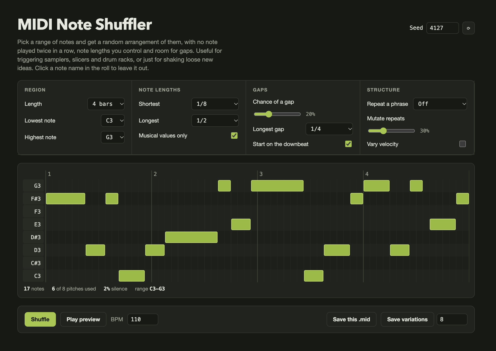

# MIDI Note Shuffler

Free, offline tool that generates random MIDI note patterns from a note range you choose. No note repeats back-to-back, and you control note lengths, gaps, phrase repeats and velocity. Great for triggering samplers, slicers and drum racks, or sparking new ideas. Exports .mid for any DAW.

## Download

Grab the zip from the [latest release](https://github.com/lewisyoung/MIDI-Note-Shuffler/releases/latest).

**No install needed.** This is a single web page that opens in your browser (Safari, Chrome, Firefox.. whatever) and works fully offline. Unzip the download and double-click the file to open it in a browser window.

## What it does

- Arranges a range of notes randomly across 1–16 bars
- Never plays the same note twice in a row
- Keeps note lengths within limits you set
- Optional gaps, phrase repeats (with mutation) and velocity variation
- Click a note name in the preview to leave it out
- Preview playback, plus batch export of multiple variations

## How to use

1. Download the file and double-click it to open in any browser. No install or internet needed.
2. Set your note range and options.
3. Press **Shuffle** until you like what you hear.
4. Click **Save this .mid** and drag the file onto a MIDI track in your DAW.

Each pattern has a seed number. Use the same seed and settings to get the same pattern back.

Note names use the C3 = middle C convention (Logic, Ableton). Some apps label that note C4; the notes are identical.

## License

Music and MIDI you make with it are entirely yours, including for commercial releases.

Free to use, share and adapt for non-commercial purposes, with credit. You may not sell this tool or include it in a paid product. Licensed under [CC BY-NC 4.0](https://creativecommons.org/licenses/by-nc/4.0/).
